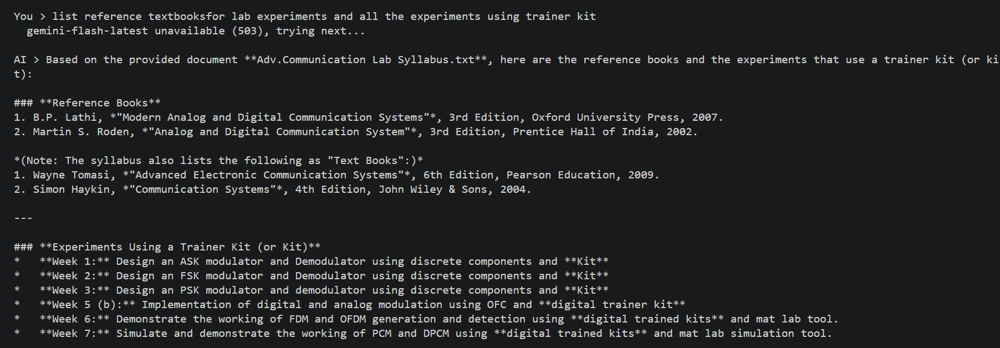
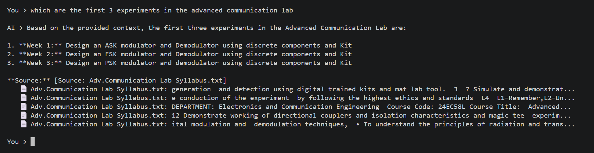
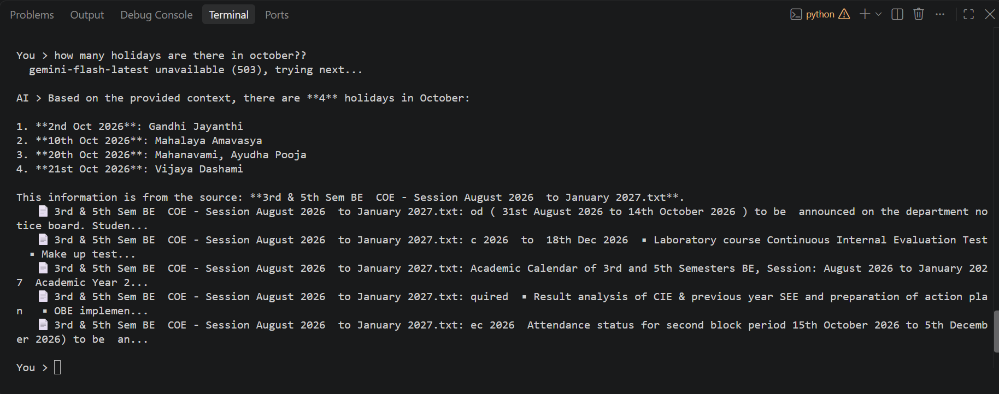

# 🧠 NoteMind AI

A RAG (Retrieval-Augmented Generation) study assistant that answers questions from your own notes, with source citations. Built with Python and the Google Gemini API.

## 📸 Screenshots

## ✨ Features
- Answers only from your notes (says "I don't know" otherwise)
- Shows the source file and snippet for every answer
- OCR for scanned and handwritten PDFs (`ocr.py`)
- Auto-switches Gemini models when one is busy
- Test script (`eval.py`): 12/12 on a 12-question test I wrote

## ⚙️ How it works
Notes → chunks (with overlap) → embeddings → cosine similarity search → top 5 chunks → Gemini answer

## 🚀 Run it
1. Install Python 3.10+
2. `pip install -r requirements.txt`
3. Get a free key at https://aistudio.google.com
4. Copy `secret_example.py` to `secret.py` and paste your key
5. Put `.txt`, `.md` notes in a `docs/` folder
6. `python app.py`

## ⚠️ Limits
- Free-tier rate limits (429/503 errors are retried)
- Handwriting OCR can make mistakes
- Notes are sent to Google's API to get answers

## 🔮 Next
Web version with a glass UI and file upload.